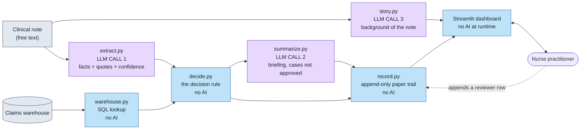
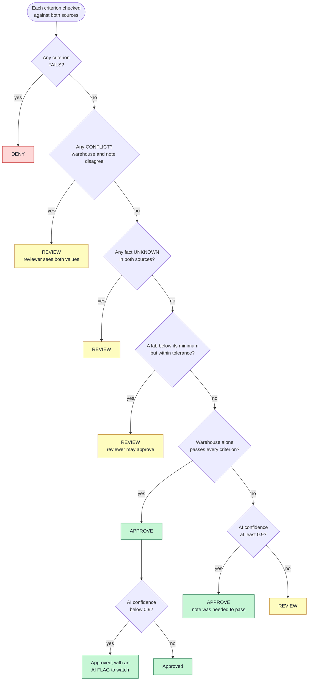

# About: prior authorization review

This project checks prior authorization requests for GLP-1 drugs against a coverage policy. Plain code decides the clear cases and a nurse practitioner (NP) decides the rest. The AI reads clinical notes into facts and writes summaries for the NP, but never decides until its performance has been validated. All data is synthetic.

---

## 1. The pipeline: deterministic steps vs LLM calls

Purple boxes are LLM calls. Blue boxes are ordinary code you can read and rerun. The three LLM calls are all the AI in the system:

| Call | Reads | Produces | Used for the decision? |
|---|---|---|---|
| `extract.py` | the clinical note | facts (diagnosis, age, HbA1c, metformin days), a quote for each, one confidence number | **Yes**: its facts are one of the two sources |
| `summarize.py` | the checks and the note | a short briefing for the reviewer | No: written after the decision |
| `story.py` | the note | a one-paragraph background of the patient | No: context only |

---

## 2. Warehouse vs AI review: two sources, one rule

Every policy criterion is checked **twice**: once in the warehouse by SQL, once in the note by the AI. Each source returns pass, fail, or unknown (it cannot say). The two are then combined:

| Warehouse | Note (AI) | Criterion result |
|---|---|---|
| pass | anything | **pass**: a warehouse pass is final |
| fail | fail | **fail** |
| fail | pass | **conflict** |
| fail | unknown | **fail** |
| unknown | pass or fail | whatever the note says |
| unknown | unknown | **unknown** |

---

## 3. The decision rule, conflicts, and the confidence threshold

---

## TODO: Feature: NP feedback as labels for ML

Use NP decisions to tune the system. ML never approves or denies.

1. **Collect labels.** For each problem criterion, the NP marks which source was right: warehouse, note, or neither. Also send a random 5% of auto-approvals to an NP.
2. **Check the AI.** Measure how often its reading is right. If it is reliable, lower the confidence gate.
3. **Set the tolerance.** See how often NPs approve near misses, and set the cost dial from that.
