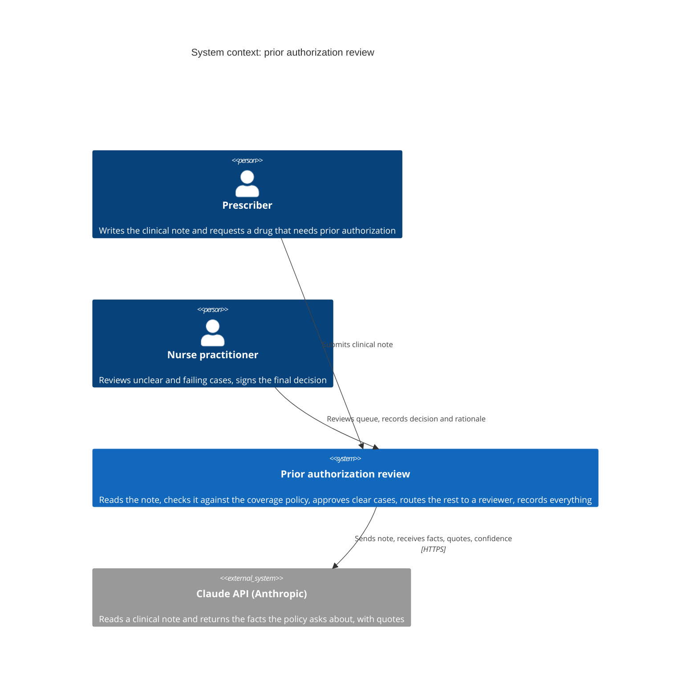
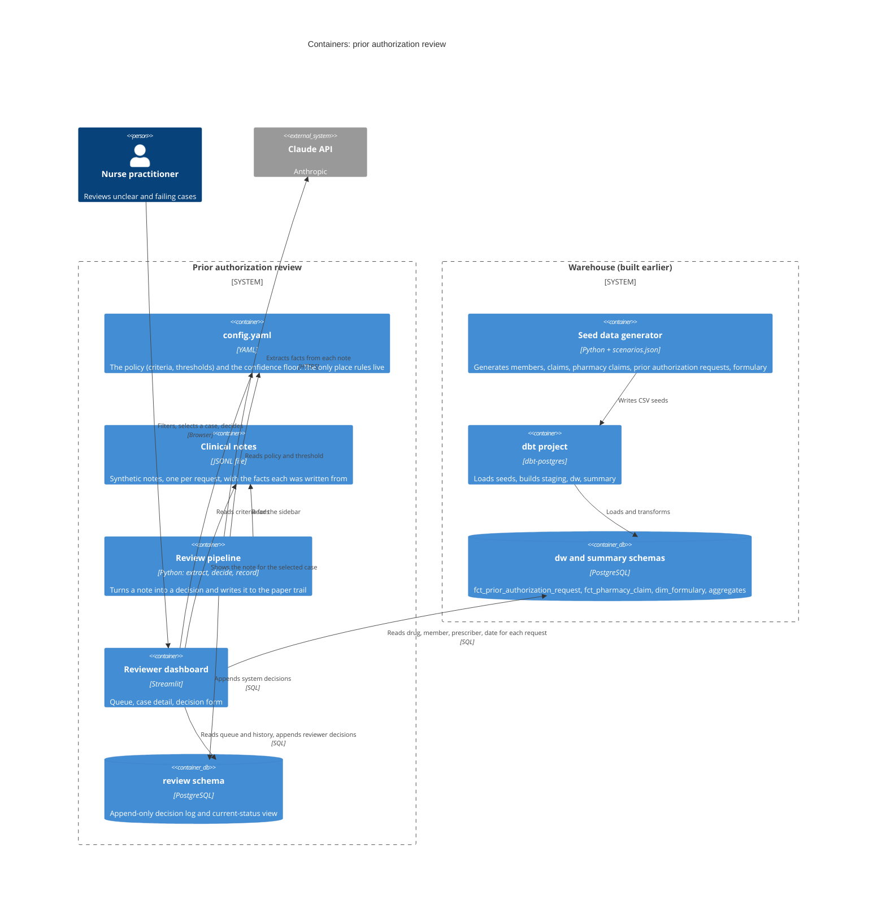
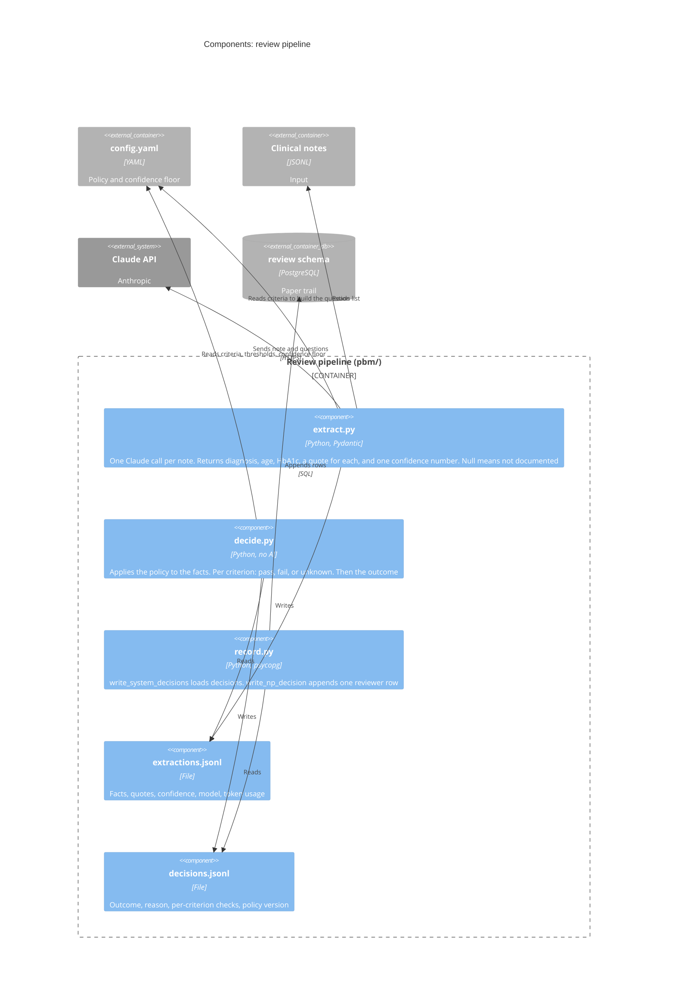
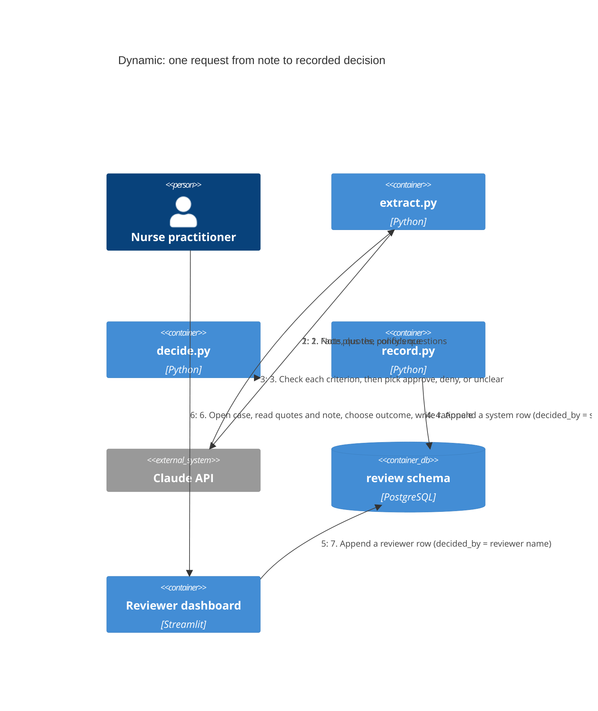
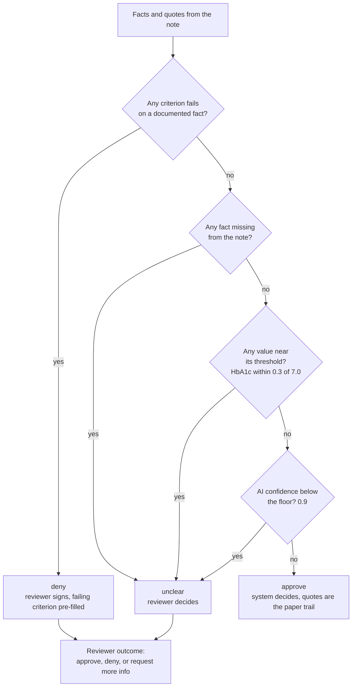
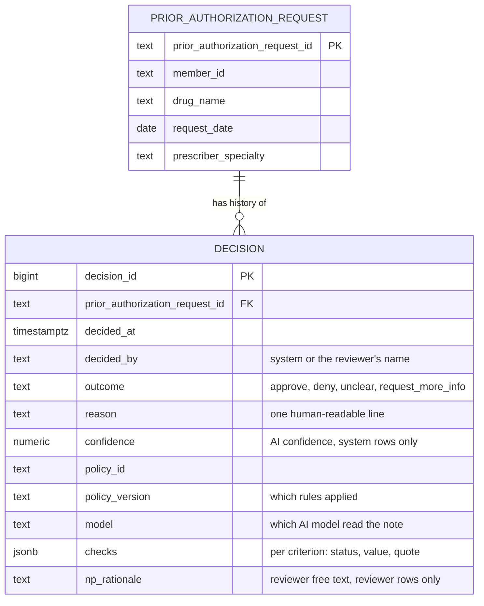

# Prior authorization review: overview

A **prior authorization** is the plan's approval that a prescriber must get before certain drugs are covered. This system reads the prescriber's clinical note, checks it against the coverage policy, approves clear cases with a paper trail, and sends everything else to a nurse practitioner (NP) in a dashboard.

Everything here uses synthetic data. The diagrams follow the [C4 model](https://c4model.com): each level zooms into one box of the level above.

| Level | Question it answers |
|---|---|
| 1. Context | Who and what does the system touch? |
| 2. Containers | What are the runnable pieces and where does data live? |
| 3. Components | What are the steps inside the review pipeline? |
| 4. Dynamic | What happens, in order, for one request? |

Supporting diagrams: the decision rule, and the paper trail table.

---

## 1. System context

The prescriber is shown for completeness. In this demo the notes are synthetic files, not a live feed.

---

## 2. Containers

Two databases' worth of schemas live in one PostgreSQL instance (`aca_health`). They are drawn separately because they are managed differently: `dw` and `summary` are rebuilt by dbt, while `review` is written by the application and never rebuilt.

---

## 3. Components: the review pipeline

Run in order: `python -m pbm.extract`, then `python -m pbm.decide`, then `python -m pbm.record`. The AI is used in exactly one place, `extract.py`. Everything after it is plain code that anyone can read and rerun.

---

## 4. Dynamic: one request, end to end

Nothing is ever updated or deleted. A request's status is simply its latest row, and its history is all of its rows in order.

---

## Supporting: the decision rule

The rule lives in `decide.py` and is configured in `config.yaml`. Strongest signal first:

The policy has three criteria: type 2 diabetes documented, age 18 or older, HbA1c 7.0% or higher. The system never denies on its own. A reviewer signs every deny, and every case that is not a clear approval.

---

## Supporting: the paper trail

One table, one row per decision event, never updated.

`PRIOR_AUTHORIZATION_REQUEST` is `dw.fct_prior_authorization_request`. `DECISION` is `review.prior_authorization_decision`. The view `review.prior_authorization_status` returns the latest decision per request, which is what the dashboard queue shows.

---

## Where each piece lives

| Piece | Location |
|---|---|
| Policy and decision settings | `pbm/config.yaml` |
| Fact extraction (Claude) | `pbm/extract.py` |
| Decision rule | `pbm/decide.py` |
| Paper trail writers | `pbm/record.py` |
| Reviewer dashboard | `pbm/app.py` (run from the repo root: `streamlit run pbm/app.py`) |
| Paper trail table and view | `infrastructure/sql/ddl/06_review_schema.sql` |
| Synthetic notes | `pbm/data/notes.jsonl` |
| Warehouse models | `transform/models/` (`fct_prior_authorization_request`, `fct_pharmacy_claim`, `dim_formulary`) |
| First-pass pipeline (archived) | git branch `archive/pbm-v1` |
